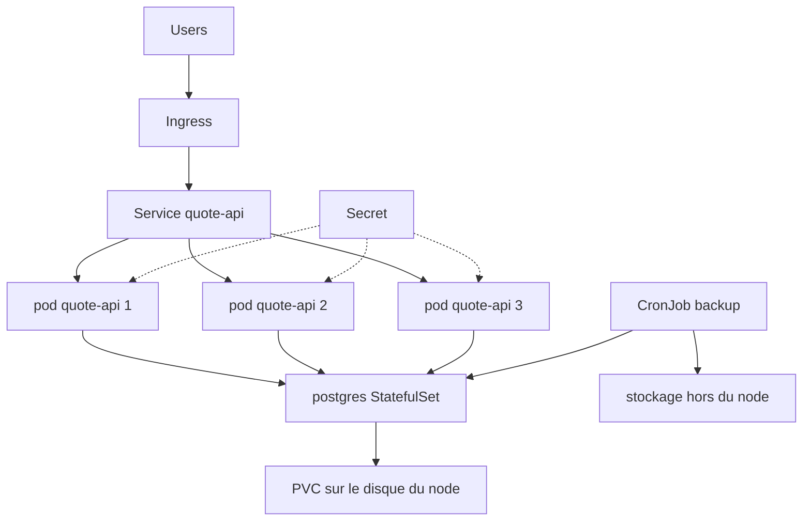

# Final Architecture - Quote API

(proposé) = mon design, pas déployé. (vérifié) = testé dans le Lab 52.

# Current System Problems

- La BDD est dans le même conteneur que l'app : si le conteneur redémarre, les données sont perdues. Fix : mettre Postgres à part dans un StatefulSet avec un PVC.
- Un seul Pod : s'il crash, l'API est down. Fix : un Deployment avec 3 replicas.
- Pas de probes : Kubernetes envoie du trafic à des Pods pas prêts et ne redémarre pas ceux qui sont bloqués. Fix : ajouter des readiness et liveness probes.
- Pas de limites de ressources : un Pod peut prendre tout le CPU/RAM du node. Fix : ajouter des requests et limits.
- Stratégie Recreate : coupure à chaque déploiement. Fix : RollingUpdate.
- Mot de passe dans le manifest : tous ceux qui ont accès au repo le voient, et il reste dans l'historique git. Fix : utiliser un Secret, créé à la main et pas commit.
- Un seul node et pas de backup : si le node ou le disque meurt, tout est perdu. Fix : backup pg_dump tous les jours stocké hors du node, et tester la restauration.

# Production Architecture

- Deployment quote-api avec 3 replicas, probes, limits, RollingUpdate (proposé)
- Service devant les pods de l'app
- Postgres dans un StatefulSet avec un PVC (proposé)
- Secret pour le mot de passe de la BDD, créé avec `kubectl create secret`, pas dans git (proposé)
- CronJob qui lance un pg_dump chaque nuit et le copie hors du node (proposé)

Ce qui se passe si :
- un Pod tombe : le ReplicaSet en recrée un et les autres replicas continuent de répondre.
- le Pod Postgres tombe : le StatefulSet le recrée avec le même PVC, donc les données sont toujours là.
- la VM ou le disque est perdu : tout est down, 3 replicas sur le même node ne servent à rien. Le PVC est perdu aussi, donc ce n'est pas un backup. Il faut recréer la VM, réappliquer les manifests et restaurer le dernier backup. Les données écrites depuis le dernier backup sont perdues.

# Operational Strategy

- Scaling : ajouter des replicas de l'app (kubectl scale ou HPA). La BDD peut seulement grossir (plus de CPU/RAM).
- Mises à jour : RollingUpdate, les nouveaux pods reçoivent du trafic seulement quand ils sont prêts. Vérifier avec `kubectl rollout status` et tester l'API. Si c'est cassé : `kubectl rollout undo`. Ça revient juste à l'ancienne image de l'app, pas aux anciennes données ni à l'ancien schéma de la BDD. Pour ça il faut le backup.
- Détecter les pannes : probes, `kubectl get pods` (restarts, CrashLoopBackOff), logs et events.
- Récupération : Deployment/ReplicaSet pour l'app, StatefulSet pour Postgres, le kubelet redémarre les conteneurs. Ils ne peuvent pas réparer un node mort, un disque perdu ou des données supprimées, pour ça il faut le backup et reconstruire l'infra.

# Weakest Point

La base de données. Il n'y a qu'un seul Postgres sur un seul node. S'il tombe, l'API est down, et si le disque meurt je perds les données depuis le dernier backup. Un Postgres répliqué ou une BDD managée réglerait ça, mais c'est plus complexe et ça coûte plus cher. Pour une petite startup, une seule BDD avec des backups testés ça suffit.
