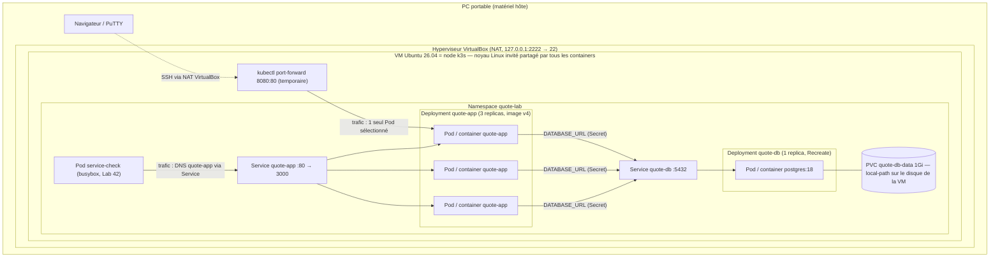

# Lab 52 — Architecture notes

## Lab 42
Résultats core + extension resources : [../42-kubernetes/verification.md](../42-kubernetes/verification.md)

k3s avait disparu de la VM en début de session : réinstallé (TODO `k3s --version`), image réimportée, manifests du Lab 42 réappliqués.

## Base de données

PVC :
```
TODO : sortie de kubectl get pvc quote-db-data (STATUS Bound)
```

Connexion app → DB : `DATABASE_URL` injecté depuis le Secret `quote-db-secret` (`secretKeyRef`). Aucune valeur de Secret dans Git.

Handlers SELECT/INSERT complétés dans `labs/20-containerized-node-app/app/app.js`, image reconstruite en `quote-app:v4` et importée dans k3s (nouveau tag, sinon le Deployment ne change pas).

Insertion via l'app (marker `res509-1794909938`), puis remplacement du Pod Postgres :
```
--- AVANT
quote-db-57d9b444f4-h4d9x   1/1   Running   0   53m
deployment.apps/quote-db restarted
deployment "quote-db" successfully rolled out
--- APRES
quote-db-7d48685b84-c7nt5   1/1   Running   0   12s
```

En base, sur le nouveau Pod :
```
 id | author |               text
  4 | RES509 | res509-1794909938
  3 | devops | If it hurts, do it more often.
  2 | linus  | Talk is cheap. Show me the code.
```

Relu via l'app après remplacement :
```
$ curl -s http://127.0.0.1:8080/ | grep -F res509-1794909938
    <div>res509-1794909938</div>
```

→ Nouveau Pod, même donnée : elle est stockée sur le PVC (`/var/lib/postgresql`), pas dans le container.

## Schéma



Les flèches représentent le trafic réseau, les boîtes imbriquées les relations « tourne dans ».

## Notes
- **Noyau partagé :** les containers de l'app et de Postgres partagent le noyau de la VM Ubuntu. La frontière d'isolation forte est la VM, fournie par l'hyperviseur, et Kubernetes ne gère que les workloads à l'intérieur.
- **Frontière stockage/panne :** un Pod app ou DB peut être remplacé sans perte grâce au PVC. Mais ce PVC `local-path` est un dossier sur le disque de cette seule VM : perdre la VM ou son disque fait perdre les données, et 3 replicas sur un seul node n'y changent rien. Backups et multi-node restent à faire.
- **Limite principale / prochaine action :** Postgres est un point unique de défaillance (1 replica, coupure pendant un restart). Prochaine étape : backups réguliers (`pg_dump` en CronJob) avant d'envisager de la haute disponibilité.
