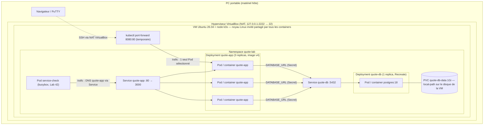

# Lab 52 — Architecture notes

## Lab 42
Résultats core + extension resources : [../42-kubernetes/verification.md](../42-kubernetes/verification.md)

VM réinitialisée le 25/11 : k3s réinstallé (`v1.37.2+k3s1`), Docker installé pour builder `quote-app:v4`, image importée dans k3s, Secret recréé et tous les manifests réappliqués.
## Base de données

PVC :

NAME            STATUS   VOLUME                                     CAPACITY   ACCESS MODES   STORAGECLASS
quote-db-data   Bound    pvc-74245f96-1801-485b-a855-bdc647bbf5c4   1Gi        RWO            local-path

Connexion app → DB : `DATABASE_URL` injecté depuis le Secret `quote-db-secret` (`secretKeyRef`). Aucune valeur de Secret dans Git.

Handlers SELECT/INSERT complétés dans `labs/20-containerized-node-app/app/app.js`, image reconstruite en `quote-app:v4` et importée dans k3s (nouveau tag, sinon le Deployment ne change pas).

Insertion via l'app (marker `res509-1795643539`), relu avant remplacement :
```
$ curl -s http://127.0.0.1:8080/ | grep -F res509-1795643539
    <div>res509-1795643539</div>
quote-db-668f85c69d-7zszf   1/1   Running   0   42s
```

Remplacement du Pod Postgres (même PVC) :
```
deployment.apps/quote-db restarted
deployment "quote-db" successfully rolled out
quote-db-7549bc99cf-kjprj   1/1   Running   0   7s
```

Relu via l'app après remplacement :
```
$ curl -s http://127.0.0.1:8080/ | grep -F res509-1795643539
    <div>res509-1795643539</div>
```
## Schéma



Les flèches représentent le trafic réseau, les boîtes imbriquées les relations « tourne dans ».

## Notes
- **Noyau partagé :** les containers de l'app et de Postgres partagent le noyau de la VM Ubuntu. La frontière d'isolation forte est la VM, fournie par l'hyperviseur, et Kubernetes ne gère que les workloads à l'intérieur.
- **Frontière stockage/panne :** un Pod app ou DB peut être remplacé sans perte grâce au PVC. Mais ce PVC `local-path` est un dossier sur le disque de cette seule VM : perdre la VM ou son disque fait perdre les données, et 3 replicas sur un seul node n'y changent rien. Backups et multi-node restent à faire.
- **Limite principale / prochaine action :** Postgres est un point unique de défaillance (1 replica, coupure pendant un restart). Prochaine étape : backups réguliers (`pg_dump` en CronJob) avant d'envisager de la haute disponibilité.
